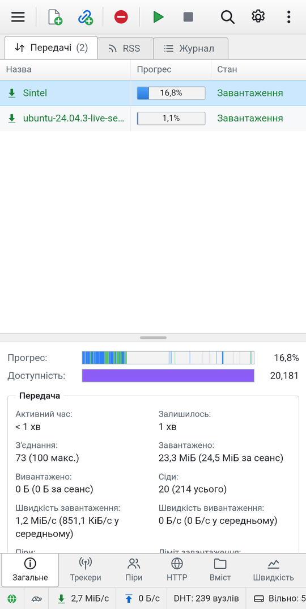
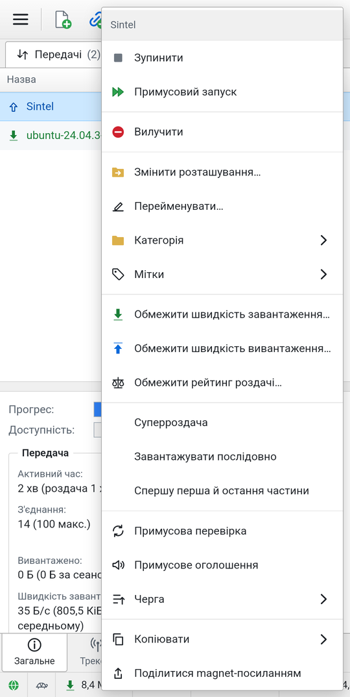
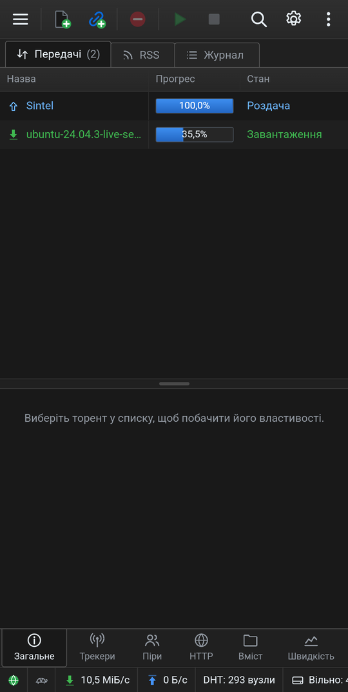

# Itorrent


Торент-клієнт для Android на рушії libtorrent — за можливостями як Flud+, а з вигляду як класичний настільний qBittorrent: панель інструментів, таблиця передач із кольоровими станами, бічна панель фільтрів, нижня панель властивостей із вкладками і рядок стану зі швидкостями.

[Завантажити APK](https://github.com/hatogg/Itorrent/raw/main/apk/Itorrent-1.0.apk)

<p align="center">
  
  
  
</p>

## Що вміє

- **Додавання торентів** — з файлу, magnet-посилання, HTTP-адреси чи хешу; можна вставити кілька посилань одразу. Відкриває `.torrent` і magnet-посилання з браузера та інших застосунків. Діалог додавання, як у qBittorrent: шлях збереження, категорія, мітки, вибір файлів і пріоритетів; для magnet-посилань метадані підтягуються просто в діалозі.
- **Рушій libtorrent 2.0**: DHT, PeX, LSD, µTP, UPnP/NAT-PMP, шифрування, веб-сіди, торенти v1, v2 і гібридні, швидке відновлення після перезапуску.
- **Керування**: запуск, зупинка, примусовий запуск, черга (вгору/вниз), перевірка, оголошення, зміна розташування, перейменування, експорт `.torrent`, magnet-посилання.
- **Послідовне завантаження** й «спершу перша та остання частини»; **перегляд відео й аудіо під час завантаження** — вбудований сервер віддає плеєру частини в потрібному порядку.
- **Вміст**: дерево файлів із прапорцями, пріоритети, перейменування файлів і тек, відкриття готових файлів.
- **Трекери, піри, HTTP-джерела**: стан кожного трекера, додавання й редагування трекерів, ручне додавання пірів, блокування піра, веб-сіди.
- **Категорії й мітки** з власними шляхами збереження; фільтри за станом, категорією, міткою й трекером.
- **Ліміти швидкості** — глобальні, альтернативні («черепаха» в рядку стану, з розкладом) і для кожного торента; **обмеження роздачі** за рейтингом і часом.
- **Живлення й мережа**: лише Wi‑Fi, лише під час заряджання, пауза при низькому заряді, лише через VPN (із прив'язкою до інтерфейсу VPN), розклад роботи, вихід після завершення всіх завантажень.
- **RSS** із автоматичним завантаженням за правилами (шаблони чи регулярні вирази, категорія, шлях, вибір каналів, перевірка збігів).
- **Створення торентів** із файлу чи папки: розмір частини, формат v1/v2/гібрид, приватний торент, трекери з рівнями, веб-сіди, одразу на роздачу.
- **Проксі** (SOCKS4/5, HTTP), **IP-фільтр** (eMule .dat, .p2p, CIDR), анонімний режим.
- **Журнал подій** і **статистика** за весь час, графік швидкості.
- Робота у фоні зі сповіщенням про швидкість і кнопками «Зупинити все» та «Вихід», автозапуск після увімкнення.
- Світла й темна теми, інтерфейс українською. Без реклами й трекерів.

## Дизайн

Інтерфейс повторює звичну логіку qBittorrent, але пристосований до дотику: рядки таблиці вищі, перший стовпець закріплений, решта прокручується вбік. Колір рядка показує стан — зелений для завантаження, синій для роздачі, фіолетовий для завершених, сірий для зупинених, червоний для помилок. Довге натискання на рядок відкриває контекстне меню з підменю, на заголовок таблиці — вибір стовпців. Вкладки властивостей розташовані внизу; натискання на активну вкладку згортає панель, а розділювач можна тягнути. Дотиком до «черепахи» в рядку стану вмикаються альтернативні ліміти, до швидкостей — діалог лімітів.

## Дозволи

Щоб зберігати завантаження в «Download/Itorrent», вибирати будь-яку папку й роздавати власні файли, потрібен дозвіл «Доступ до всіх файлів». Без нього завантаження зберігаються в папці застосунку.

## Обмеження

- HTTPS-трекери працюють без перевірки сертифіката: OpenSSL у libtorrent4j для Android зібраний без доступу до файлів, тож не бачить системних кореневих сертифікатів. З'єднання з трекером однаково шифрується.
- Пошукових плагінів, як у настільному qBittorrent, немає — торенти додаються з файлів, посилань і RSS.

## Збирання

Потрібні JDK 17 і Android SDK.

```bash
./gradlew assembleRelease
```

GitHub Actions збирає APK на кожен push, запускає в емуляторі справжні завантаження й знімає інтерфейс, а результати кладе в гілку `ci`. Щоб підпис APK не змінювався між збірками, додайте секрет `ITORRENT_KEYSTORE_B64` (keystore PKCS12 у base64, псевдонім `itorrent`) і за потреби `ITORRENT_STORE_PASS`.

## Ліцензії

- [libtorrent](https://github.com/arvidn/libtorrent) — BSD, © Arvid Norberg.
- [libtorrent4j](https://github.com/aldenml/libtorrent4j) — MIT, © Alden Torres.
- Зовнішній вигляд натхненний [qBittorrent](https://www.qbittorrent.org); Itorrent не пов'язаний із проєктом qBittorrent.

---

<sub>🇬🇧 **Itorrent** is an Android BitTorrent client powered by libtorrent, with a Flud+-level feature set and a classic qBittorrent-style interface: toolbar, colour-coded transfer list, filter sidebar, bottom properties panel and status bar. Magnet links, DHT/PeX/LSD, sequential download and streaming, file priorities, categories and tags, speed limits with a scheduler, RSS auto-downloader, torrent creator, proxy and IP filter. No ads, no trackers, Ukrainian UI.</sub>
